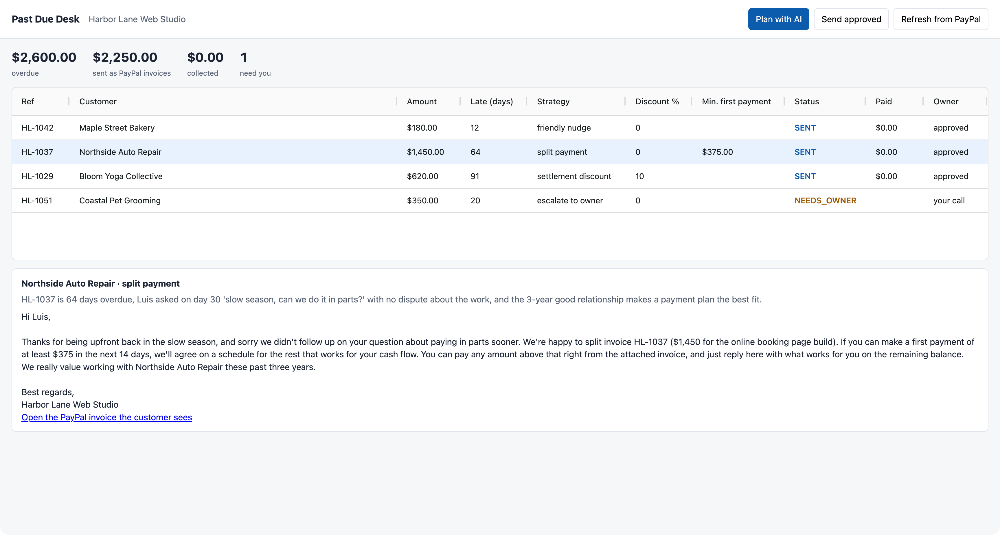

# Past Due Desk

An AI collections desk for small businesses. It reads the overdue invoices in the owner's books,
decides how to recover each one (a friendly nudge, a firm reminder, a split payment, a settlement
discount, or "this one needs you"), writes the email, and sends it as a **PayPal invoice** that the
customer can pay right away. The owner's policy, enforced in code, has the last word on money.

Built by Design Master Solutions LLC for the PayPal AI Hackathon. We build websites and systems for
small businesses, and "how do I chase the clients who owe me without losing them?" is a question we
hear every month.



Demo video (1:43): [docs/demo.mp4](docs/demo.mp4). The customer side is PayPal's hosted invoice: [docs/paypal-invoice.png](docs/paypal-invoice.png).

## Problem

A one-person studio, a bakery, a repair shop: they invoice, some customers pay late, and the owner
either sends nothing (awkward) or the same angry template to everyone (and loses good customers).
What actually works depends on the customer: the one who always pays 10 days late needs a nudge,
the one who asked "can we do it in parts?" needs a plan, the one who disputes the work needs a human.

## What it does

1. **Plan with AI.** For each overdue account the agent reads amount, days late and the relationship
   history, and returns a structured plan: strategy, reason (citing the record), discount, minimum
   first payment, new due date, email subject and body, and the note printed on the invoice.
2. **Policy guardrail.** `enforcePolicy` clamps the model to the owner's limits (max discount, discount
   only after N days, minimum first payment ratio, due-date window) and logs every correction, shown
   in the dashboard as "Policy corrected the AI". Disputes become `escalate_to_owner`: no invoice is sent.
3. **Owner approves** each plan in the AG Grid dashboard (human in the loop for anything that moves money).
4. **PayPal does the collecting.** Approved plans become PayPal Invoicing v2 invoices: discount as an
   item discount, split plans as `partial_payment` with a `minimum_amount_due`, the AI's email as the
   invoice note, then `send`. The customer gets PayPal's hosted invoice and pays with PayPal or card.
5. **Refresh from PayPal** syncs status (`SENT`, `PARTIALLY_PAID`, `PAID`) and paid amounts back into the grid.

The ledger is written after every invoice, so a crash never sends the same invoice twice, and an
account with a live invoice is never re-planned.

## PayPal surfaces used

- OAuth2 client credentials (`/v1/oauth2/token`)
- Invoicing v2: create (`POST /v2/invoicing/invoices`) with item discounts and partial payments,
  send (`/send`), read (`GET`), remind (`/remind`)
- Hosted payer view (`recipient_view_url`) linked from the dashboard

## AI used

- A Claude model plans each account (`src/agent.mjs`). Backends: `anthropic` (Messages API,
  `ANTHROPIC_API_KEY`), `claude-cli` (Claude Code headless), and `replay`, which reads the answers
  recorded in `fixtures/llm/` so anyone can run the demo without an AI key. Fixtures are keyed by a hash
  of the exact prompt, so a changed record never replays a stale answer.
- The model proposes; deterministic code decides what is allowed. The AI never touches PayPal directly.

## Run it

Requires Node 22+. No npm install (no dependencies; AG Grid Community loads from a pinned CDN URL with SRI).

```bash
# PayPal sandbox app credentials: developer.paypal.com > Apps & Credentials > Sandbox
export PAYPAL_CLIENT_ID=...  PAYPAL_CLIENT_SECRET=...
npm start                     # http://localhost:8790
# Plan with AI -> Approve -> Send approved -> Refresh from PayPal
```

CLI equivalent: `npm run plan`, `node src/cli.mjs approve HL-1037`, `npm run send`, `node src/cli.mjs sync`.

AI backend: `LLM_BACKEND=replay` (default, uses the recorded answers for the sample books),
`LLM_BACKEND=anthropic ANTHROPIC_API_KEY=...`, or `LLM_BACKEND=claude-cli`. Add `RECORD=1` to save new answers.
Your own books: `BOOKS=path/to/receivables.json` (same shape as `data/receivables.json`).

Tests: `npm test` (policy clamps, escalation, JSON parsing, invoice payload).

## Sample run (sandbox, 28 Oct 2026)

| Account | Days late | AI plan | PayPal |
|---|---|---|---|
| Maple Street Bakery, $180 | 12 | friendly nudge, due in 7 days | INV2-7XEX-86K6-LHVW-CR45, SENT |
| Northside Auto Repair, $1,450 | 64 | split payment, first payment at least $375 | INV2-RACQ-9R7U-9UB6-PHYB, SENT, partial payments on |
| Bloom Yoga Collective, $620 | 91 | settlement discount 10% | INV2-CVB7-UBU8-45R8-P7UM, SENT, $558.00 due |
| Coastal Pet Grooming, $350 | 20 | escalate to owner (customer disputes the logo) | no invoice |

The sample customers are fictional; the invoices are real sandbox objects.

## What it does not do

- It does not decide disputes, threaten, or report anyone to collections.
- It does not store card data; payment happens on PayPal's hosted invoice.
- The sample books are a JSON file; a production version would read them from the accounting system.

## License

MIT, Design Master Solutions LLC.
